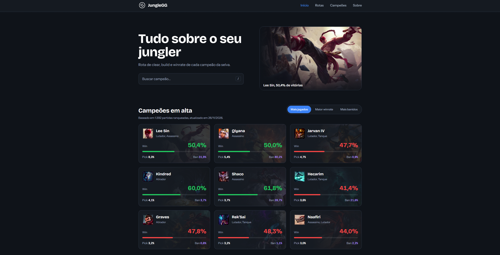
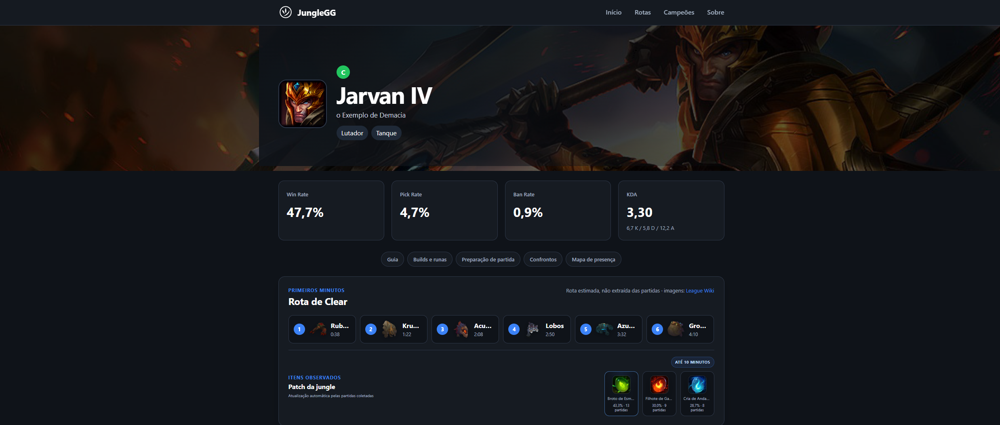
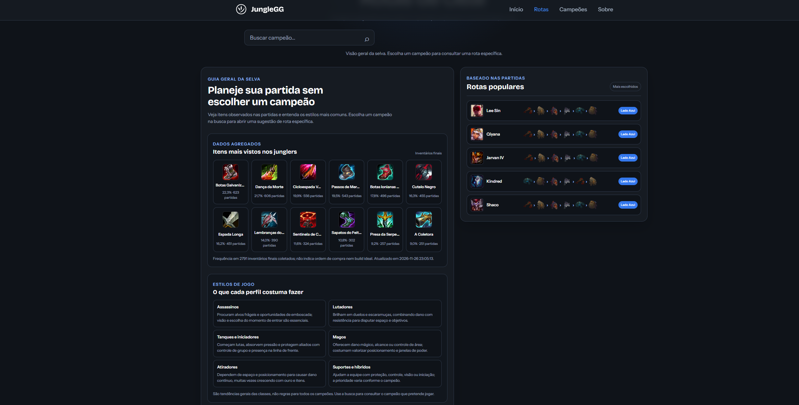
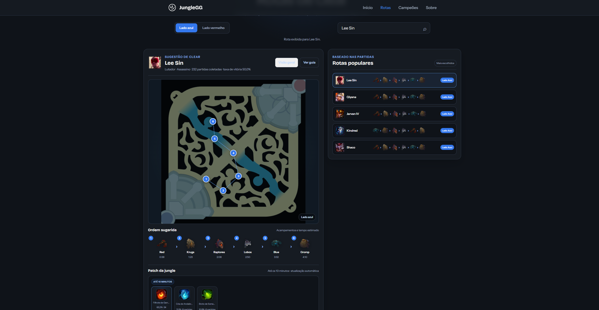

# JungleGG

### Dados claros para tomar decisões melhores na selva

Estatísticas de League of Legends organizadas para comparar campeões, rotas de clear,
builds, runas, confrontos e movimentação pelo mapa.

 
 

---

## Sobre o projeto

> [!NOTE]
> Esta é uma versão em evolução. Algumas telas e dados podem sofrer ajustes,
> novos bugs podem aparecer e novas partidas continuam ampliando as amostras.

O **JungleGG** transforma dados de partidas ranqueadas em uma experiência rápida e visual.
Em vez de dispersar informações em tabelas complexas, o projeto apresenta cada campeão
com os dados que mais ajudam na preparação da partida.

As estatísticas são observadas em partidas reais e podem mudar conforme o patch,
a amostra disponível e o comportamento atual dos jogadores.

## Principais recursos

### Campeões em destaque

Descubra os junglers mais escolhidos, mais banidos e com melhor taxa de vitória.
Filtre por nome ou classe e abra o guia completo de cada campeão.

  

### Rotas de clear

Compare a ordem dos acampamentos, o tempo estimado de cada etapa e a perspectiva
dos lados azul e vermelho.

  

  

### Builds e runas observadas

Veja os itens finais, páginas de runas e escolhas mais frequentes registradas nas
partidas coletadas. Também é possível consultar os itens de patch usados nos
primeiros 10 minutos.

### Preparação por confronto

Analise confrontos favoráveis e desfavoráveis, o resultado por lado do mapa e
os contextos com amostra suficiente para uma leitura responsável.

### Mapa de presença

Visualize as posições de movimentação e abates participados pelo jungler ao longo
das partidas disponíveis.

---

## Como os dados são apresentados

- Taxas são exibidas somente com amostra mínima suficiente.
- Build significa inventário final observado, não uma ordem obrigatória de compra.
- Patch inicial representa itens comprados até os primeiros 10 minutos.
- Confrontos com poucos dados são marcados como amostras baixas.
- Informações antigas continuam disponíveis caso uma atualização esteja temporariamente indisponível.

---

## Tecnologias

O projeto usa dados públicos da API da Riot Games e do Data Dragon.

---

## Contato

---

> [!IMPORTANT]
> JungleGG não é aprovado pela Riot Games e não reflete as opiniões da Riot Games
> ou de qualquer pessoa oficialmente envolvida com League of Legends.
>
> League of Legends e Riot Games são marcas ou marcas registradas da Riot Games, Inc.
